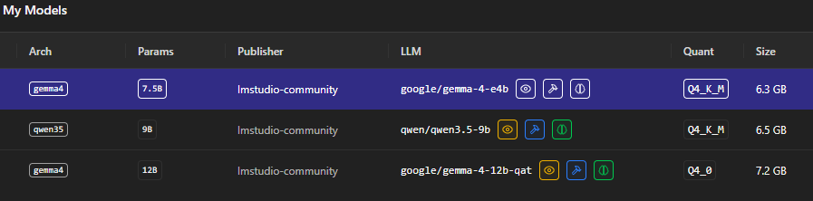
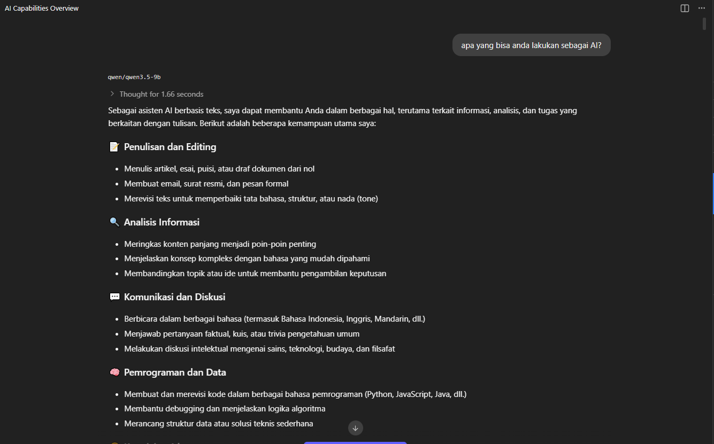

import { Image } from "astro:assets";
import LmStudioLogo from "../../assets/logo/lm-studio-logo-color-white.svg";

## Kenapa LLM local?

Gw pikir dengan langgan berbagai AI diluar sana sudah cukup, sampai gw nemu article tentang LLM local. Penasaran akhirnya gw coba dan ternyata bagus juga. Apalagi untuk kebutuhan sehari hari.
Seperti ngebaca dokumen, ngerangkum, baca email, nulis sesuatu, dll.

Disini gw mau sharing pengalaman gw mengunakan LLM local, kelebihan dan kekurangannya.

> Kelebihan
> - Jelas gratis, bebas pilih model
> - Gak pake internet juga bisa
> - Privasi aman

> Kekurangan :
> - Tergantung spec hardware
> - Harus install
> - Kalo mau update model harus install lagi

Sebelum lanjut gw akan membahas sedikit tentang LLM. 

LLM adalah Large Language Model yang merupakan model AI yang dirancang untuk memahami dan menghasilkan teks. LLM adalah teknologi yang mendasari banyak aplikasi AI modern seperti ChatGPT, Gemini, Claude, dan lain-lain. Disini berjalan diatas hardware kita sendiri, contohnya PC, laptop, dll. 
Tools yang populer ada LM Studio, Ollama, dll. 

Dalam model LLM perlu diperhatikan beberapa fitur, seperti : 
- Parameters, yaitu jumlah parameter dalam model. Semakin besar parameternya, semakin baik performanya. Namun, semakin besar parameternya, semakin besar juga ukuran modelnya. Contohnya: 7B, 13B, 30B, 70B, dll.
- Quantization, yaitu teknik untuk mengurangi ukuran model tanpa mengurangi performanya. Biasanya diindikasikan dengan huruf seperti Q4, Q8, dll. 
- Context length, yaitu panjang konteks yang dapat diproses oleh model dalam satu waktu. Biasanya diukur dalam jumlah token. Contohnya: 4096, 8192, 16384, dll.
- GGUF, format file model yang digunakan oleh LLM. 

Disini gw akan sedikit membahas tools yang selama ini dipake buat LLM local yaitu [LMStudio](https://lmstudio.ai/). 

<Image src={LmStudioLogo} alt="LM Studio" class='w-1/6'/>

Untuk spesifikasi hardware gw yaitu : 
- Ryzen 5 7500F
- Radeon RX 7800 XT 16GB
- 32GB RAM

Perlu diingat, semakin tinggi spesifikasi hardware maka semakin baik performa LLM local. Biar tau model mana yang kuat buat dicoba bisa coba cek di [LLM Fit](https://llmfit.io/).
Kita juga bisa menggunakan metode Offloading nanti akan gw bahas di part selanjutnya.

Untuk model yang gw siapin seperti ini dan gak lebih dari 12B, bisa dicari dan download di menu "Model Search".

Jika sudah di download bisa langsung di load modelnya di menu "My Models" -> "Local Models" -> lalu pilih model yang ingin di load. Gw disini pake model Qwen3.5-9B.

Coba masukkan prompt "Apa yang bisa anda lakukan sebagai AI?" dan tunggu hasilnya. Kurang lebih hasilnya akan seperti ini.

Bagian yang gw suka dari LM Studio yaitu ada fitur untuk melakukan "Offloading", tetapi tidak hanya itu saja masih banyak fitur lainya yang patut dicoba. Model LLM sendiri memiliki beberapa fitur yang dibuat khusus seperti Vision, Reasoning, Code Interpreter, Tool Calling, dll. Untuk detail fitur lainya akan gw bahas di part selanjutnya. Stay tune!