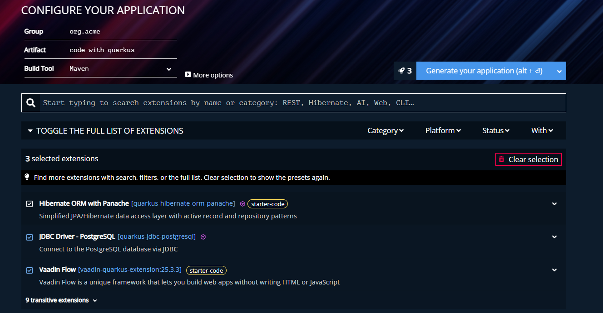

## Why Quarkus + Vaadin? 

Before I use Quarkus and Vaadin, I used Spring Boot for backend and some frontend framework like React, Vue, Nuxt, etc. I have been using them for years, but for me building web application become too complex and overkill.

I want something simple and efficient. Something that can help me to build a web application quickly and efficiently. And also low resource usage. 

Quarkus is a Java framework that can help us to build a web application quickly and efficiently. Vaadin is a framework that can help us to build a web application quickly and efficiently.
But this time I want to try Quarkus and Vaadin. You can build a web application with low resource usage. 
And of course it's build on top of GraalVM. It mean it can be compiled to native binary. Which make it really fast to startup and low resource usage. Perfect for microservices architecture.

But you have to consider this, when you have to pick which one is better to use for your project. 

Spring has mature ecosystem and community. If you encounter any problem, you can find the solution easily. 
Quarkus is still new. But it is growing fast and has a lot of potential. It has popular packages and extensions that can help you to build a web application quickly and efficiently. 

## Getting Start with Quarkus and Vaadin

You can go to this website https://code.quarkus.io/

Choose your extensions / packages. Here image that I choose. You can choose another one based on your project requirements.



Then click on Generate button. It will download the project. Extract it into your workspace.

Before we continue further. Let me tell you bit difference between Spring Boot and Quarkus. 

## Difference between Spring Boot and Quarkus

If you already familiar with Spring Boot, you will find that Quarkus is very similar to Spring Boot. 

Let's focus on Dependency Injection first. 

In Spring Boot, we use @Component to create a bean. 

```java
@Component
public class MyComponent {
    public void doSomething() {
        System.out.println("Hello World");
    }
}
```

But in Quarkus, we use @ApplicationScoped to create a bean. 

```java
@ApplicationScoped
public class MyComponent {
    public void doSomething() {
        System.out.println("Hello World");
    }
}
```

Most of time you will use @ApplicationScoped, @RequestScoped, @Singleton, and @Dependent.

There are also @Inject to inject a bean. which is similar to Spring Boot or you can use constructor injection.

But there are more. You can find more information here https://quarkus.io/guides/cdi-reference.

There is list of all available packages and extensions in https://quarkus.io/extensions.

Next, let's talk about other extensions that I used for this project. 

## Quarkus Extensions

### Hibernate ORM with Panache

First, why we don't use pattern like getter and setter? It's already discussed in https://github.com/quarkusio/quarkus/discussions/29179.
In panache, you can use active record pattern like this. 

```java
@Entity
@Table(name = "products")
public class Product extends PanacheEntity {
    public String name;
    public double price;
}
```

Or repository pattern like this. Pretty similar with Spring Data JPA.

```java
@ApplicationScoped
public class ProductRepository extends PanacheRepository<Product> {
    public List<Product> findByPrice(double price) {
        return list("price", price);
    }
}
```
Make sure you have to wrap it with @Transactional. In service layer or business layer.

You can find more information here https://quarkus.io/guides/hibernate-orm-panache.

### Vaadin UI

I choose Vaadin because it's build on top of web component. Which mean it's already have a lot of features that we need to build a web application. And also it's using Java as the programming language. So we can use Java to build a web application. Not like before that we have to use Javascript to build a web application.

Basic example of Vaadin UI:
```java
@Route("")
public class MainView extends HorizontalLayout {
    public MainView() {
        TextField name = new TextField("Name");
        Button sayHelloBtn = new Button("Say hello");

        add(name, sayHelloBtn);

        // Server-side logic, the Button is type-safe and event-driven
        sayHelloBtn.addClickListener(e -> {
            System.out.println("Hello, " + name.getValue());
        });
        sayHelloBtn.addClickShortcut(Key.ENTER);
    }
}
```

It's simple and straightforward. Just like when we using Swing or JavaFX. There is no difference to create a UI component in Java. When your web application is build with Vaadin, it's automatically compiled to Web Component and running on a browser. So there is no need to create a UI component in Javascript.

For now, Vaadin is provide a lot of UI component that we need to build a web application. You can find more information here https://vaadin.com/docs/latest/flow/overview/. 

## Conclusion

So I think this is for now. It's simple, efficient and low resource usage. And if you tired using Spring Boot and want to try something new, you should give it a try. But you have to consider this, you have to learn new things. I think it'll be my standard for building a web application for now. 

Next, I will share my experience using Quarkus and Vaadin for building a web application. Stay tuned! 